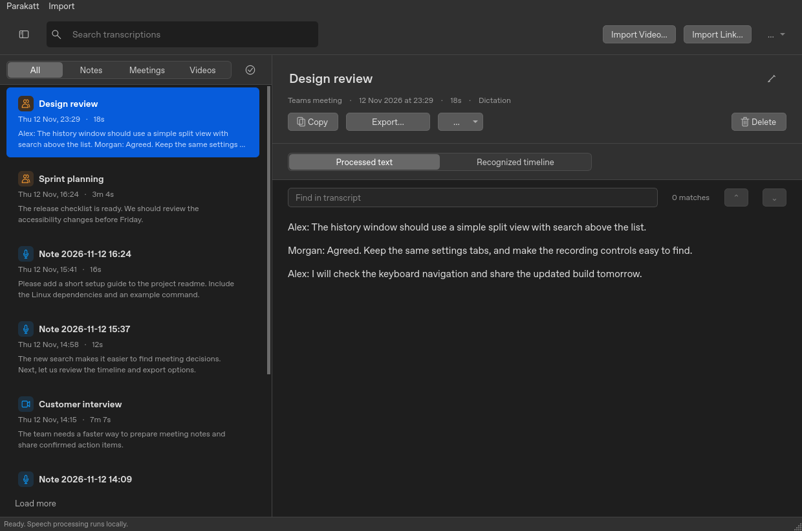
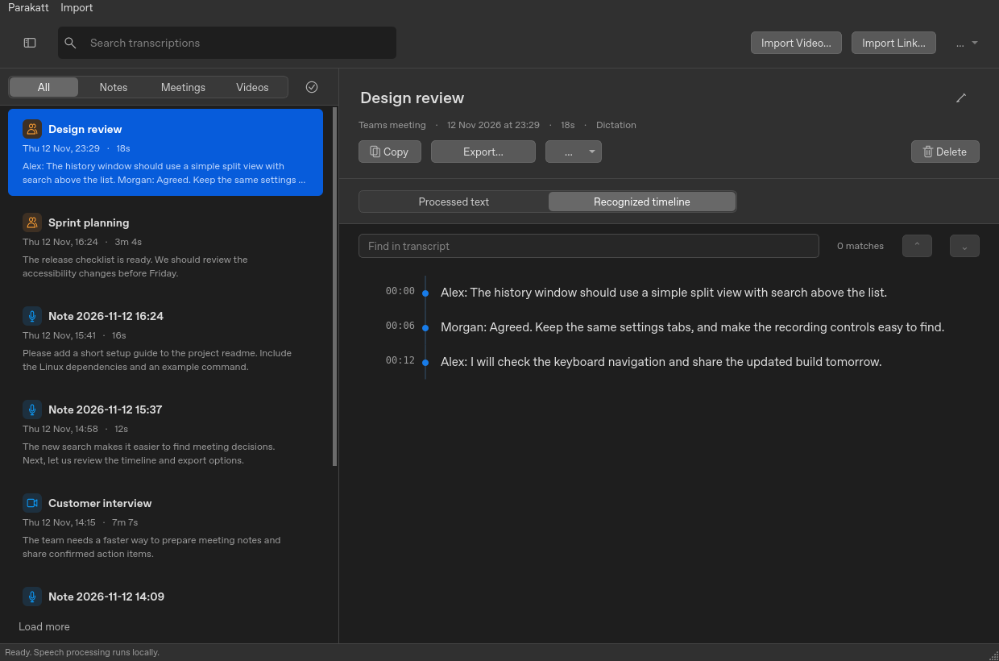
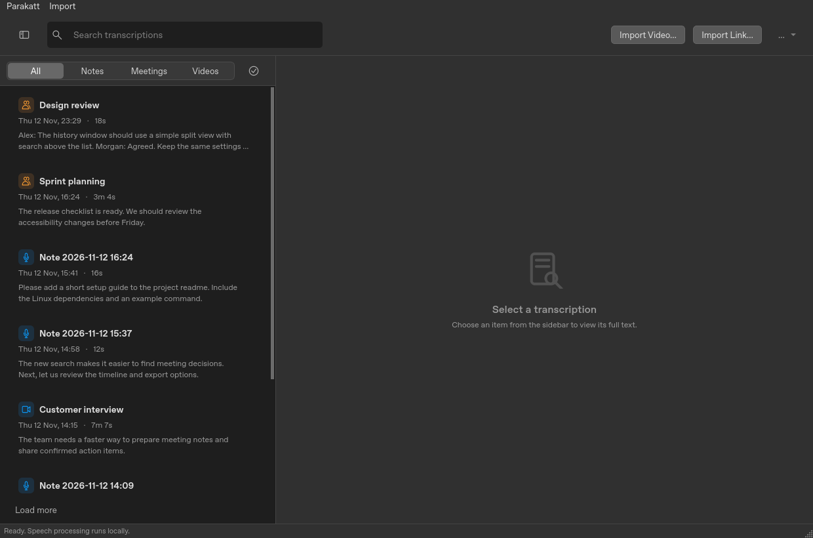
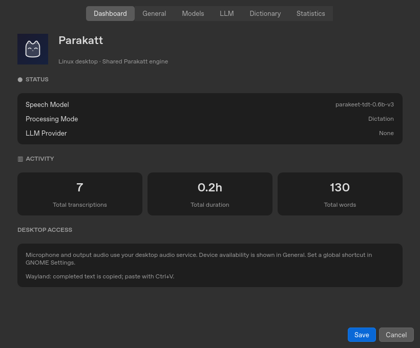
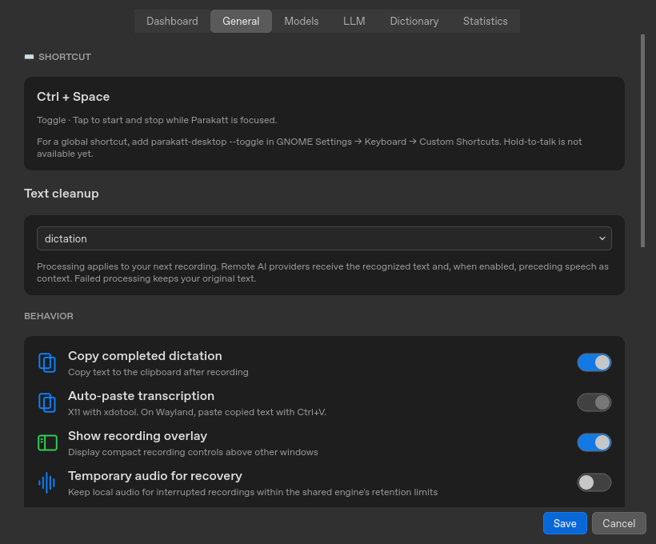
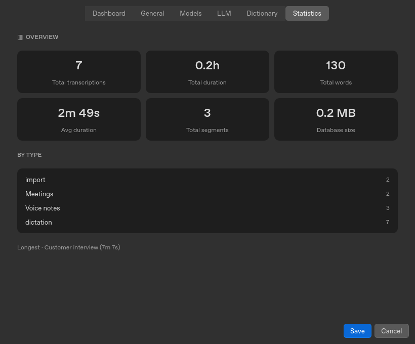
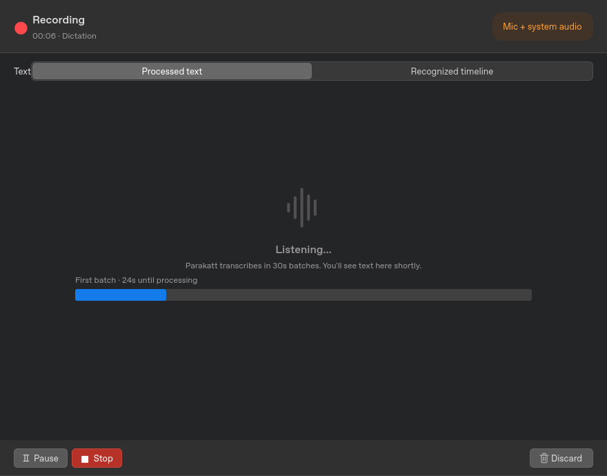
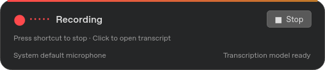

# Linux interface alignment

The history, settings, meeting window, and recording overlay now follow the supplied macOS screenshots. This replaces the previous green sidebar/serif prototype with neutral dark surfaces, blue selection, compact controls, and system sans-serif text. Linux retains its native window controls; GNOME shortcut and Wayland clipboard limitations remain explicit.

## History

The top toolbar contains sidebar visibility, search, video/link imports and an additional-actions menu. All/Notes/Meetings/Videos filters sit above the list. The detail pane contains title/metadata, copy/export/actions/delete, processed text or recognized timeline, and find with previous/next navigation. Transcript and title edits require an explicit Save changes action.

Teams and Slack transcript imports appear under Meetings. Audio/video imports appear under Videos. Imported speaker corrections are reflected in both text and timeline. The extra menu retains original recognized text, speaker correction, confirmed meeting actions, undo and retry. Media playback remains available when a source is attached.







## Settings

Dashboard, General, Models, LLM, Dictionary and Statistics form the top tab bar. Existing settings still persist through the shared engine. General contains shortcut guidance, processing mode, clipboard behavior, overlay, recovery, debug logging, source labels, audio devices, retention and custom modes. Model download controls, import management, backups, profiles and recovery are still reachable.

Unavailable saved audio devices and a saved preview-model identifier are retained when the device service or model catalog is unavailable.







## Recording

Meetings have a separate window with elapsed time, source badge, processed/timeline selector, first-batch progress, Pause/Resume, Stop, and Discard. The overlay has the recording indicator, measured microphone level, Stop, shortcut hint, microphone and model status. It avoids requesting keyboard focus.





## Reproducing the screenshots

Build the Linux native bindings and install the desktop dependencies first, then run:

```sh
QT_QPA_PLATFORM=offscreen PYTHONPATH=linux \
  target/linux-venv/bin/python -m parakatt_linux.preview --output target/linux-ui-preview
```

The preview uses a temporary database and synthetic office conversations. Recording states are staged without opening audio devices; the meter remains at zero. These are actual Qt widget captures, without window-manager decorations. They demonstrate layout, not hardware recording or GNOME integration.

Behavioral tests cover filtering/pagination, find and timeline navigation, edit persistence, settings tabs and saved unavailable devices, separate windows, chronological live segments, paused-audio exclusion, timer pause accounting, discard cleanup, and original-source video decoding/seeking. Real recognition uses an injected audio fixture. Actual GNOME Wayland focus, clipboard, global shortcuts, audio devices, output monitors and window placement still require a logged-in desktop check.
